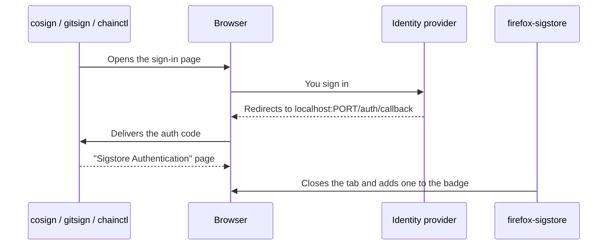

<p align="center">
  
</p>

<h1 align="center">firefox-sigstore</h1>

<p align="center">
  <em>You signed in. The tab can go.</em>
</p>

<p align="center">
  <a href="https://github.com/gruffled/firefox-sigstore/actions/workflows/release.yml"></a>
  <a href="https://github.com/gruffled/firefox-sigstore/releases/latest"></a>
  
</p>

A Firefox extension that closes the "auth successful" tabs left open by
`cosign`, `gitsign` and `chainctl auth login`.

Based on the Chrome extension [imjasonh/chrome-sigstore](https://github.com/imjasonh/chrome-sigstore).

## How it works

Those tools finish their OAuth flow on a page served from localhost, and
browsers don't let a page close itself. So every sign-in leaves a tab behind.
This extension closes it as soon as it loads, and the toolbar badge counts how
many it has closed.



By the time the page loads, the CLI already has its code, so closing the tab
doesn't affect the Fulcio certificate, the signature or the chainctl token.

It closes a tab only when both of these hold:

- the URL is `http://localhost:<any port>/...` or `http://127.0.0.1:<any port>/...`
- the title and path are `Sigstore Authentication` at `/auth/callback`, or
  `Chainguard Authentication` at `/callback`

It asks for the `tabs` and `storage` permissions and collects no data.

## Install

Needs Firefox 140 or later, or a browser built on it such as Zen. Tested in Zen
1.24.3b (Firefox 160.0.1), and in Firefox 160 in CI.

1. Download the `.xpi` from the [latest release](https://github.com/gruffled/firefox-sigstore/releases/latest).
2. Drag it onto a browser window, or open `about:addons`, click the gear menu
   and choose **Install Add-on From File…**
3. Click **Add**.

Mozilla signs each release, so it installs without changing any browser
settings. Releases don't update automatically. To upgrade, install the newer
`.xpi` the same way.

## Recommended CLI config

Set a default identity provider so the browser goes straight to the IdP
without asking which one to use:

```sh
git config --global gitsign.connectorID https://accounts.google.com
chainctl config set default.social-login google-oauth2
```

## Development

### Load from source

1. Open `about:debugging#/runtime/this-firefox`.
2. Click **Load Temporary Add-on…** and pick `manifest.json`.

The browser removes it when it restarts.

### Test

CI runs all three checks on every pull request and every push to `main`, and
a release goes ahead only if they pass. CI runs the browser test in headless
Firefox.

```sh
# Runs background.js against a stubbed browser API. No browser needed.
node test/background.test.mjs

# Runs Mozilla's add-on linter on the packaged extension.
scripts/lint.sh

# Launches Zen on a throwaway profile with the extension loaded and checks
# which fake auth tabs it closes. Pass a Firefox binary path to test in
# Firefox instead, and set MOZ_HEADLESS=1 to hide the window.
python3 test/browser_e2e.py
```

The lint and browser test run Mozilla's `web-ext` through `npx`, at the
version pinned in `scripts/web-ext.sh`.

### Release

1. Bump `version` in `manifest.json` and merge to `main`. AMO rejects a
   version number it has already signed.
2. Tag the merge commit and push the tag:

   ```sh
   git tag -s v0.0.3 -m v0.0.3
   git push origin v0.0.3
   ```

The [release workflow](.github/workflows/release.yml) checks the tag matches
`manifest.json`, runs the three checks, builds the package with
`scripts/build.sh` and has Mozilla sign it as an unlisted add-on. It then publishes a GitHub release with the signed `.xpi`. Signing
usually takes a few minutes. If the job fails partway, re-run it. A version
AMO has already signed is downloaded, not uploaded again.

The workflow needs the AMO API key and secret from
<https://addons.mozilla.org/developers/addon/api/key/> as repository secrets:

```sh
printf %s "$WEB_EXT_API_KEY" | gh secret set WEB_EXT_API_KEY
printf %s "$WEB_EXT_API_SECRET" | gh secret set WEB_EXT_API_SECRET
```

To check the secrets and run AMO's validator without creating a version, run
the workflow by hand from the Actions tab.

`scripts/amo_sign.py` calls the AMO API using only the Python standard library,
so the job holding the AMO secrets runs no third-party code. To sign locally,
export the same two variables and run:

```sh
python3 scripts/amo_sign.py sign "$(scripts/build.sh)" dist/firefox-sigstore.xpi
```

The add-on ID `sigstore-close-post-auth@gruffled` belongs to the AMO account
that first signed it. Only that account can sign new versions.

## Differences from the Chrome version

| Chrome | Firefox |
|---|---|
| `background.service_worker` | `background.scripts`. Firefox MV3 runs background scripts as an event page |
| Match pattern `http://localhost:*/*` | Firefox match patterns can't contain ports, so `background.js` checks the host itself. It also matches `127.0.0.1` |
| Matches on the title and host | Also requires the callback path, so a page elsewhere on localhost with the same title stays open |
| Re-queries every tab on every tab update | Checks only the tab that changed, and only on `url`, `title` and `status` changes |
| `host_permissions: http://localhost/*` | Dropped. `tabs` already exposes the URL and title |
| — | `browser_specific_settings.gecko` sets the add-on ID, needed for `storage.sync` and signing, and declares no data collection, which AMO requires |
| — | Restores the badge count at startup and closes matching tabs that are already open, such as tabs restored from the last session |
